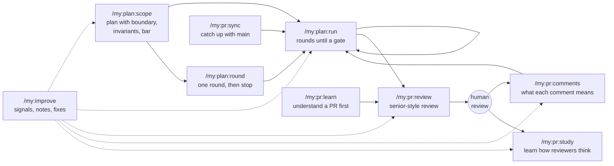

# my-agent-kit

A personal suite of skills for working on code with agents. It turns a task into a scoped plan, runs the work in autonomous rounds that stop only at agreed gates, reviews changes the way a senior colleague would, and gets better every time something goes wrong.

It ships as a Claude Code plugin named **`my`**, so every skill is one keystroke away: type `/my` and the menu lists them all.

## Why it exists

Long pull requests fail in predictable ways:

- the bar for "done" is set late, so reviews never converge;
- the boundary of the change is discovered halfway through;
- scope grows without a budget;
- claims go unverified;
- the developer ends up as a courier, carrying messages between agent sessions.

This kit encodes the fixes as reusable skills. It also keeps a log, so each new failure mode becomes a new fix.

## The workflow

The menu is organised by object: `plan:*` for a change and its plan, `pr:*` for a pull request and its review, `improve:*` for the kit itself.



You step in only at **gates**, which the plan agrees in advance:

1. approving the plan;
2. a decision outside the agreed bar or boundary;
3. marking the change ready for human review;
4. anything that gets published (PR text, review comments, replies, messages).

Between gates, agents work in the background: `plan:run` starts the next round on its own as long as each one succeeds, a verified round pushes to the draft branch, and one desktop notification tells you when you are needed.

## A change, end to end

```text
/my:plan:scope ABC-123     interview → plan → worktree + branch from origin/main → ticket In Progress
/my:plan:run               rounds one after another: triage → check → execute → verify → review → push,
                           until a gate, new PR comments, conflicts with main, the bar, or 5 rounds
/my:plan:round             one round and a 6-line report, when you want to watch each step
/my:pr:sync                when a round reports that main moved with conflicts
/my:pr:comments            bots and reviewers answered → fixes feed the next /my:plan:run
/my:pr:study               ten minutes on how the reviewer thinks (only new comments)
/my:pr:learn 456           understand a colleague's PR first…
/my:pr:review 456          …then review it (reuses the reading)
/my:improve                whenever you want to see what the kit has learned, or fix it
```

## Commands

| Command            | Stage       | What it does |
| ------------------ | ----------- | ------------ |
| `/my:plan:scope`   | Before code | Interviews you with multiple-choice questions and writes the plan: goal, boundary, invariants with tests, bar for done, size budget, reviewers, gates. Adapts its depth to the kind and size of the task. |
| `/my:plan:round`   | During      | Runs one round: executes the work in the background, checks the result against git, reviews it against the plan, and reports in six lines with a drift signal and the lessons it logged. |
| `/my:plan:run`     | During      | Runs rounds one after another while each succeeds, carrying block findings to the next round and ticking plan parts; stops at a gate, failed verification, drift over budget, conflicts with main, new PR comments, red CI, anything to publish, the bar, or 5 rounds; one summary at the end. |
| `/my:pr:sync`      | During      | Brings the branch up to date with main: previews conflicts, stops on design conflicts, regenerates generated files, re-checks migrations and the dev database. Accepts optional context ("keep their approach, adapt ours"). |
| `/my:pr:review`    | Review      | Reviews a pull request, yours or a colleague's, through the lenses senior reviewers use: promised guarantees, state ownership, durability, every caller, rollback, the roadmap of others. Returns the questions to ask and findings graded against the bar. |
| `/my:pr:comments`  | Review      | For each bot or colleague comment: two lines of plain explanation, whether it is real, its weight, a proportional action and a short reply draft. |
| `/my:pr:learn`     | Learning    | Understand a PR before reviewing it: what and why, before → after, reading order, its promise, questions to keep in mind. Private, in your language. |
| `/my:pr:study`     | Learning    | Turn the review comments you received into a three-layer study page; only comments not studied yet. Private, with a glossary and reviewer profiles. |
| `/my:improve`      | Always      | `note` logs a problem with the kit from any session; `digest` turns the signals every skill collects while you work into a few clear notes; `run` finds the upstream lesson behind open notes and turns it into approved changes, eval cases, a version bump and an updated README; `log` shows the history, each note with its problem in one line and a state badge, closed ones folded away. |

Behind them are three skills with modes: `plan` (scope, round, run), `pr` (learn, study, review, comments, sync) and `improve` (note, digest, run, log). You rarely need the names: ask in plain words ("explain PR 456", "run the plan") and Claude picks the command from its description.

## The status line (optional)

`my-status` is a small mod that shows, in one line above the prompt, where the work stands: the plan's parts as tiles that fill up, the percentage, the time left, what needs you, and the next action as a button (it fills the prompt with the command; you press Enter). "Open plan" shows the plan in a pane. It reads the state file `plan:round` and `plan:run` write, plus `git` and `gh`; it never changes your files. The kit works the same without it.

## Principles

All skills share one set of rules, kept in [docs/principles.md](docs/principles.md):

- proportional rather than strict;
- the plan as contract;
- humans decide at gates;
- questions come with pros and cons;
- verify before deciding, including the agent's own claims;
- checks enter the bar only after their baseline is measured;
- repository rules are loaded explicitly;
- work happens in a worktree, unless the project profile says how you work there instead;
- a fresh session is named after the work, not the command;
- links point only to files the app can open;
- reasoning is in the user's language, and repository vocabulary is never translated;
- the kit learns while it is used: every skill collects signals and digests them into notes.

## Install

**On the development machine**, link the repository into the personal skills folder. From the next session, Claude Code loads it automatically, straight from disk, as `my@skills-dir`:

```bash
ln -s "<path to your clone>" ~/.claude/skills/my
```

**On any other machine**, install it from the private GitHub repository. This uses your existing `gh` or git credentials:

```bash
claude plugin marketplace add lorenzocadamuro/my-agent-kit
claude plugin install my@my-agent-kit
```

The repository is private, so nobody else can install it.

**The status line mod** is installed on its own, from your clone used as a local marketplace. The marketplace also lists `my`: do not install that one where `~/.claude/skills/my` already loads the kit, or it loads twice.

```bash
claude plugin marketplace add "<path to your clone>"
claude plugin install my-status@my-agent-kit
```

Edits to `mods/my-status` reach a session with `/reload-plugins`.

## Improving the kit

The kit grows with use, but it never changes itself without approval.

1. **Signals.** While you work, every skill records signals without interrupting you: a free "Other" answer, a dismissed question, a reversed decision, a reviewer comment the plan should have caught, rework. At the end, `/my:improve digest` groups them into a few clear notes in `~/.my-agent-kit/suite-log.md`: repeats merge, withdrawn ones drop, and a cause already open gains an evidence line instead of a new note. You can also add a note by hand with `/my:improve note <what happened>`.
2. **Run.** Whenever you like, from any session, `/my:improve run` looks for the upstream lesson behind the open notes (the question that should have been asked, and the existing rule that should have covered it) and proposes refining that rule rather than adding a patch. It applies only the changes you approve.
3. **Prove.** Each fixed note becomes an eval case in `evals/`. `claude plugin eval` must pass before the change lands, so a fixed problem cannot come back.
4. **Record.** Every run updates this README, `CHANGELOG.md` and the version in `.claude-plugin/plugin.json`, then commits and tags.

Changes take effect from the next session.

### Versioning

The kit follows [semantic versioning](https://semver.org):

- **patch** for wording and fixes;
- **minor** for a new skill or new behaviour;
- **major** when a command or its arguments change incompatibly.

## Repository layout

```
.claude-plugin/
  plugin.json        plugin manifest (name "my", version)
  marketplace.json   lets the private repo act as its own marketplace
skills/<name>/       plan, pr and improve: a SKILL.md that routes to one file per mode
commands/<skill>/    thin sub-commands that call a skill in one mode (/my:<skill>:<mode>)
evals/<skill>/       eval cases, one per problem the kit has learned from
mods/my-status/      the optional status line mod (hooks module, its state contract, tests)
docs/principles.md   rules every skill follows
docs/                question format, review lenses, local data layout
templates/           plan, project profile, round, round summary, log entry, reviewer profile, study page
scripts/check.sh     validation and privacy check, run by the pre-commit hook
scripts/verify-round.sh  checks a round summary against git
scripts/drift.sh     size versus budget, distance from main, conflict preview
.githooks/           git hooks (enable with: git config core.hooksPath .githooks)
.claude/CLAUDE.md    instructions for agents editing this repository
CHANGELOG.md         what changed in each version
```

## What never goes in this repository

This repository holds only generic, reusable material. Anything tied to an employer or to people stays local, in `~/.my-agent-kit/`:

- the improvement log and retrospectives;
- reviewer profiles and study pages;
- internal paths, project names, ticket or pull request numbers, and colleagues' names.

`scripts/check.sh` blocks a commit that contains any word listed in `~/.my-agent-kit/deny-words.txt`. That file is local and never committed.

## Development

```bash
git config core.hooksPath .githooks   # once per clone
scripts/check.sh                      # validate the plugin and run the privacy check
```

Evals run locally, never published; see [evals/README.md](evals/README.md):

```bash
claude plugin eval . --no-publish --runs 1 --max-cost-usd 12 --trust-plugin \
  --ablation none --allow-tools Bash Write Edit --scaffold -j 4
```

The mod has its own checks:

```bash
claude plugin validate mods/my-status
claude plugin test mods/my-status
```
