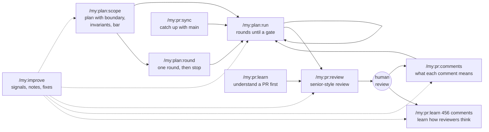

# my-agent-kit

A personal suite of skills for working on code with agents. It turns a task into a scoped plan, runs the work in autonomous rounds that stop only at agreed gates, reviews changes the way a senior colleague would, and gets better every time something goes wrong.

It ships as a Claude Code plugin named **`my`**, so every skill is one keystroke away: type `/my` and the menu lists them all.

## Why it exists

Long pull requests fail in predictable ways:

- the bar for "done" is set late, so reviews never converge;
- the boundary of the change is discovered halfway through;
- scope grows without a budget;
- claims go unverified;
- the developer ends up as a courier, carrying messages between agent sessions.

This kit encodes the fixes as reusable skills. It also keeps a log, so each new failure mode becomes a new fix.

## The workflow

The menu is organised by object: `plan:*` for a change and its plan, `pr:*` for a pull request and its review, `improve:*` for the kit itself.



You step in only at **gates**, which the plan agrees in advance:

1. approving the plan;
2. a decision outside the agreed bar or boundary;
3. marking the change ready for human review;
4. anything that gets published (PR text, review comments, replies, messages).

Between gates, agents work in the background: `plan:run` starts the next round on its own as long as each one succeeds, a verified round pushes to the draft branch, and one desktop notification tells you when you are needed. Each agent runs on the model `docs/model-choice.md` names for its role: agents that only search run on Sonnet, every other agent on the session's model, so the model you choose for the session sets the cost. Small work takes a light lane: for a plan with `Size: S`, `plan:scope` starts no agent, and each round skips the triage check and is carried out by the session itself; a fresh agent still reviews every round, even a fix of a few lines the session writes itself or that you ask for directly, before it is pushed.

**Decisions you hand over.** Each decision you take at a gate of `plan:*` or `pr:sync` belongs to a kind: a generic judgement ("for X, choose Y") kept in `method.md` in the data root, with no repository, project, code or person names. The plan's Decisions table records the option the kit recommended and the one you chose; an assumption the kit makes without you counts for nothing. After 5 matches in a row, the next gate proposes handing that kind over, and only your yes does it. From then on the kit decides that kind alone, by its judgement, when a decision clearly fits it and research does not point elsewhere, and lists each one as "decided alone (handed over: K<n>)". A mismatch resets the count and takes the hand-over back; so does telling the kit in chat. Architecture, design, speaking for you, plan approval, crossing the boundary or a repository rule, anything published, ready for review, a release, someone else's code and moving the local stack are never handed over. `/my:improve:method` lists the kinds.

## A change, end to end

```text
/my:plan:scope ABC-123     worktree + branch from origin/main, ticket In Progress → interview → plan in its .plans/
/my:plan:run               rounds one after another: triage → check → execute → verify → review → push,
                           until a gate, new PR comments, conflicts with main, the bar, or 5 rounds
/my:plan:round             one round and a 6-line report, when you want to watch each step
/my:pr:sync                when a round reports that main moved with conflicts
/my:pr:comments            bots and reviewers answered → fixes feed the next /my:plan:run
/my:pr:learn 456 comments  ten minutes on how the reviewer thinks (only new comments)
/my:pr:learn 456           understand a colleague's PR first…
/my:pr:review 456          …then review it (reuses the reading)
/my:improve                whenever you want to see what the kit has learned, or fix it
```

## Commands

| Command            | Stage       | What it does |
| ------------------ | ----------- | ------------ |
| `/my:plan:scope`   | Before code | Opens the change's worktree from `origin/main` as soon as the ticket is read, with the files the repository's `.worktreeinclude` lists, and, when the profile says the session follows the worktree, moves it there so the app's Changes and Terminal show it; the plan is made where it will run. Interviews you with multiple-choice questions, asking only what the plan and its first part need, and writes the plan: goal, boundary, invariants with tests, bar for done, size budget, reviewers, gates. Its research follows what the plan adds or changes: who writes and reads each new field, state, key or rule, saved data included, and the rule each caller of shared code applies; a production volume or frequency a recommendation depends on is measured first, or the recommendation says it is unverified. When the change adds work to a hot path (per operation, per item, per frame, per request), it times that path on a large case and proposes a cost check for the bar. An item left out of scope gets a ticket, or, when you accept it as it is, its reason in the plan and no ticket. Adapts its depth to the kind and size of the task. Never assumes your approval: without the question tool it stops at "Plan approval". |
| `/my:plan:round`   | During      | Runs one round: estimates the production lines each item adds, and asks the size gate before executing when the round would cross the split trigger; executes the work in the background (in the S lane, the session itself), checks the result against git, has a fresh agent review it against the plan, and reports in six lines, with a drift signal, the decisions taken alone and the lessons it logged. When your answer at a gate changes a rule the plan states in several places (boundary, invariants, tables), every place is updated together. |
| `/my:plan:run`     | During      | Runs rounds one after another while each succeeds, carrying block findings to the next round and ticking plan parts; stops at a gate (drift over budget among them) unless its kind is handed over and clearly fits, failed verification, conflicts with main, new PR comments, red CI, anything to publish, the bar, or 5 rounds; one summary at the end, with the decisions it took alone. |
| `/my:pr:sync`      | During      | Brings the branch up to date with main: previews conflicts, leaves every design conflict to you (other PRs' text only builds the options), regenerates generated files, re-checks migrations and the dev database. Context you type yourself that says how to resolve, general or per file ("keep their approach, adapt ours"), is your decision for every design conflict it clearly covers, and it says in one line per file how it applies it; any other design conflict stays a question. Each option has its own Pros, Cons and Risk. |
| `/my:pr:review`    | Review      | Reviews a pull request, yours or a colleague's, through the lenses senior reviewers use, starting from the promise: its main scenario followed end to end through every piece, then coherence between pieces, state ownership, durability, every caller, rollback, the roadmap of others. First a private analysis in chat: ready to merge or not and why, findings weighed by who can trigger them and what they cost, and "nothing worth adding" when that is the answer. On a PR already reviewed, right after the verdict it says what the head fixed since the last review, and points to threads others already opened instead of repeating them; each thread's resolved state comes from a GitHub GraphQL query tried on a real PR. Only once you agree come the questions to ask and the comment drafts, then the publishing gate. Your own PR is reviewed by fresh agents that did not write it. |
| `/my:pr:comments`  | Review      | For each bot or colleague comment: two lines of explanation, whether it is real (a claimed bug only once reproduced through the code that calls it in production, otherwise "not verified" with the command that would decide it), its weight, a proportional action and a reply draft: short for a bot; for a colleague's review, one reply for the whole review, fixed points included, that explains where the behaviour comes from and what the alternative would cost, without taking a stance. |
| `/my:pr:learn`     | Learning    | Understand a PR before reviewing it: what and why, before → after, reading order, its promise, questions to keep in mind, and last a few lines on the review comments it has (who said what, what is still open). With a focus on review comments (a comment id or URL, a reviewer, or `comments`), it studies the comments you received instead: a three-layer study page, only comments not studied yet, with a glossary and reviewer profiles. Private. |
| `/my:improve`      | Always      | `note` logs a problem with the kit from any session, through a script that numbers it under a lock, so two sessions writing at the same moment never share an id; `digest` turns the signals every skill collects while you work into a few clear notes; `run` explains each group of open notes by a concrete case of what went wrong and what will change for you, finds the upstream lesson behind them and turns it into approved changes, eval cases, a version bump and an updated README, in its own worktree, and ships only after showing you the diff and getting your yes, then updates the plugins you installed; `log` shows the history, each note with its problem in one line and a state badge (an open note from an older kit version marked `from <version>`), closed ones folded away; `method` lists the decision kinds and which ones are handed over. A note's target is a skill and mode, or `principles`, `templates`, `scripts`, `mod`, `profile:<repo>`, or `style:<name>` for a reply that broke an output style's rules (`style:ITE`). |

Behind them are three skills with modes: `plan` (scope, round, run), `pr` (learn, review, comments, sync) and `improve` (note, digest, run, log, method). You rarely need the names: ask in plain words ("explain PR 456", "run the plan") and Claude picks the command from its description.

## The status line (optional)

`my-status` is a mod that shows, in a band above the prompt and in the status line, where the work stands, from the first step of `plan:scope` to the end of a run. On the desktop app the band is drawn as pictures, in their own colours for the system's light or dark scheme; on the terminal it says the same in characters. The kit works the same without it.

**What the band shows:**

- **The header:** the state (Planning, Ready, Running, Needs you, Stopped, Done); a second line with where the work is (Running: the part, the step under way and "step k of n"; Needs you and Stopped: the reason, two or three words, and the step; Ready: "Plan approved" or "Round N done", and the next step; Done: "Bar met · all steps verified"; Planning: its step, among Research, Interview, Write, Review and Approval); and up to three figures with their captions: the share of the plan's steps done (`82%`, "9 of 11 steps"), the time left (an estimate from the finished rounds, "estimating…" until one has finished, "on hold" when stopped) and the time since the work started ("total time" once done). Planning shows the elapsed time alone; the percentage needs steps, and the time left needs parts.
- **The parts:** one capsule per part, one segment per step, filled as steps are done; the step under way and a failed step stand out, and in Ready the next step is outlined. Under them a label row: each part's letter and short title, or the letter alone when the title does not fit. The chevron beside the capsules opens the steps under each part, every step with its label, done parts included, and closes them; the label row stays as it is.
- **The actions,** in the bottom-right corner, Open plan last, in the corner itself: Ready offers One round and Run plan, Stopped One round; each fills the prompt with its command, and you press Enter. Needs you says "Answer in the chat below ↓", or, once the question has scrolled out of view, offers Show question, which scrolls the chat back to the newest assistant message. For a plan, Open plan shows it in a pane: outside Planning always, in Planning once the plan file exists.
- **Signals:** new PR comments by other people and conflicts with main are never a state of their own: they show in the action row, beside the state's actions, as "Review comments (n)", and as "Conflicts with main" with "Merge main".
- **Background agents** of the session, below the plan, only while there is kit work (a plan's state file, or a `pr:*` or `improve run` activity): up to four rows (the task as its spawner described it, in whole words up to 60 characters, the model and its effort, the tool in use, the time), then "+ n more"; one waiting reads "Waiting for your answer" in Needs you, and a finished one leaves after 10 seconds. Their head folds and opens them.
- **The pulse:** in Running, and only then, the state mark, the step under way and the running agents pulse; under reduced motion they stay still.
- **An activity:** `pr:*` modes and `improve run` show only the header, Running or Needs you with their mode and the time since the mod first saw them, then their background agents; no parts and no actions.

On the desktop, text is fitted to its room by whole words and whole pieces: the second line drops whole pieces when it meets the figures, a short title shows whole or not at all, step labels wrap (in the rows view their chips flow onto new lines), an agent's task shows the words that fit, and its running tool shows whole, then without the argument's folders, then its name alone. An agent's task is first limited to its whole words within 60 characters (a first word longer than 60, to its first 60), and a running tool's argument to its first 60 characters, on the terminal too; a single word wider than its room is drawn whole past it. When the band is taller than the room the app gives it, the agents fold to their head (unless you opened them), then, with the steps open, each part not started (every step still to do) shows as one "n to do" chip, a part half done keeping its steps; past that the app scrolls the band. On the terminal, the agents fold when the rows run out; the second line, the label row, the step rows and the agent rows (before their time) are cut at their end when too long for the width, and the other rows are not cut: the header needs up to about 80 columns with three figures, and a part's capsule a cell per step in its column, so on a narrower terminal they do not fit.

The band's own text never names the work, the plan's title or the PR: only states and modes, part letters and short titles, step labels, reasons, figures and actions. Two places show other text as it is written: an agent's task, as its spawner described it, and the Open plan pane, titled with the plan's title. The status line reads `my: <state>[ · extras] · <n> kit notes`, the extras being Planning's step, Running's percentage and time left, an activity's mode, then, beside a plan's state, new comments and conflicts (`my: Ready · 3 comments · 2 kit notes`). `/my-status` refreshes the band and opens the plan; `/my-status measure` reports the desktop calibration (px per row and per column) and what the band last measured.

**What it reads.** The state file `plan:scope`, `plan:round` and `plan:run` write: `plan:scope` records when the work started and each part's short title (two or three words, at most 16 characters, so it fits under its part) and steps, two or three words each; `plan:round` records each round's start and end; and every write derives each step's status from the plan's boxes and the open round with `scripts/state-steps.sh`, never by hand (done, running, to do, or failed when verification blames its item). A state file written by kit 5.6.0, without steps or short titles, still draws: numbered segments, labelled from the steps it lists as left, the short title from the heading after "Part X:", and the time left "estimating…". The mod also reads the progress sidecar, only for its `updatedAt`, which keeps a running file fresh (its item counts are no longer shown); the activity sidecar of `pr:*` modes and `improve run`; whether the plan file exists, and its text for the pane; the open kit notes; the session's agents; and `git` and `gh`. It never changes your files. A chat shows only its own planning and activity, even when several chats work in the same folder (without a session id, the folder's file); planning inside the change's worktree is the worktree's file, shown to every chat there. A planning, running or activity state untouched for 6 hours is ignored; one without an `updatedAt` never is. New comments count only other people's, and a failed network call shows nothing rather than zero.

## Output languages (optional)

The kit sets no language and no sentence form for what Claude writes for you. `my-language` is a mod that ships two output styles, and its `/language` command switches between them in the terminal and in the desktop app:

- **ITE**, simplified technical Italian. Its rules: one idea per sentence, at most 20 words in an instruction and 25 in a description, the active voice, no gerund, no "viene" passive, no support verbs.
- **STE**, simplified technical English in the spirit of ASD-STE100. Its rules: imperative steps, short sentences, no contractions, no "should" or "may", no semicolons or em-dashes.

A style covers every text written for you to read: the chat, reports, questions, notifications, chapter titles, study pages, signals and the reasoning in log notes. Code, commits, plans and `.plans/` files, prompts for agents and drafts for other people keep the repository's rules. Claude Code puts the active style in the system prompt, so each reply is written once, already in that form: nothing translates or rewrites it afterwards. The kit's content rules (the why before the what, the question format, terms kept as they are) stay in the kit and apply under any style. Without the mod, or with `/language off`, replies follow Claude Code's defaults.

**Switch.**

```text
/language          lists the styles and off, marking the active one and naming the settings that set it
/language STE      replies follow STE from your next message
/language off      Claude Code's Default style: no rule from this mod
```

`/language` writes `outputStyle` into the folder's `.claude/settings.local.json`, the same key `/output-style` writes, and keeps every other key. The choice stays for that folder until you switch again, also after `/clear` and `/compact`; two sessions in the same folder share it.

**Set ITE as your default** in `~/.claude/settings.json`; a folder's own `/language` choice wins over it:

```json
{ "outputStyle": "my-language:ITE" }
```

Leave Claude Code's own `language` setting (the "Language" row of `/config`) at its default: once set, it adds a second language rule beside the style.

**Add a style:** a Markdown file in `mods/my-language/output-styles/`, with front matter `name` (the file name without `.md`), `description` and `keep-coding-instructions: true`, the scope sentence the other styles carry, and form rules only. `/language` lists it from the next session, with no code change, and `mods/my-language/scripts/packs.test.sh` checks it. Bump the mod's version so the installed copy gets it.

**Measure a reply** against ITE's rules: `python3 mods/my-language/scripts/ite-check.py reply.md` (or the reply on stdin) prints one finding per line and the findings per 100 words. It measures and never blocks. Text in double quotes counts as cited, so the forms it shows as examples raise no finding. Measure the reply's Markdown when you can; text copied from the app loses list markers and headings, so the checker reads each line as its own paragraph and a line with tabs as a table row. A file wrapped at a fixed width is under-counted, since each line counts as a paragraph.

**Stop or roll back.** `/language off` stops the style in this folder only. To stop it everywhere, remove `outputStyle` from `~/.claude/settings.json` and from each folder's `.claude/settings.local.json`, where `/language` writes it, then run `claude plugin uninstall my-language@my-agent-kit`. To return to 5.8.0, where the kit set its own language rules, do all of that first. With the install from a clone (the symlink in [Install](#install)), check out `v5.8.0` in the clone and restart. The install from GitHub follows the repository and has no version option: `claude plugin install` and `claude plugin marketplace add` take none.

ASD-STE100 is a registered trademark of ASD. The STE style follows its spirit; it is not the official standard, and ASD did not certify it. STE is adapted from AminBlg/SimpleEnglish (MIT): see `mods/my-language/THIRD-PARTY.md`.

## Principles

[CONSTITUTION.md](CONSTITUTION.md) comes first: what the kit is for, and what it must not become. It changes only by hand or at your explicit request, and it wins over every other rule. `/my:improve run` checks each proposal against it, refuses what it forbids, and for the cause behind such a note proposes only what it allows. When you want an amendment, the kit asks it as its own question, with today's text and the new text.

All skills share one set of rules, kept in [docs/principles.md](docs/principles.md), which serve the constitution:

- proportional rather than strict;
- the plan as contract;
- humans decide at gates;
- questions come after an introduction in chat (the situation, what the kit prescribes, what the choice changes), and stay short; a change to the constitution is always its own question; every option carries its own labelled Pros and Cons, and a question in your answer gets an answer before any new question;
- decisions are learned as kinds, and a kind is decided alone only after you hand it over;
- verify before deciding, including the agent's own claims, your own proposals and the premise of each recommendation (a recommendation never rests on an invented number, nor only on keeping today's behaviour), and check what you say you see against the session record instead of contradicting you from memory; the writer is never the reviewer; a check or a stop condition is never relaxed without your yes;
- what the kit relies on, or hands you, runs once for real first, and checks enter the bar only after their baseline is measured and they were seen failing on the change's likeliest wrong input; a condition that happens only after the merge becomes a separate verification ticket;
- repository rules are loaded explicitly;
- work happens in a worktree, unless the project profile says how you work there instead; the session enters it with EnterWorktree and the app's change-directory tool, never a `cd`, and counts as moved only when the app says so;
- a fresh session is named after the work, not the command;
- a file you must read opens in the app's pane, and a text you must approve is pasted in chat; nothing published cites your study pages, reviewer profiles or other personal material;
- in the kit's own repository, work branches may be pushed, but `main` and tags move only at the release gate, after the full diff and your yes;
- the kit sets no language or sentence form for what it writes for you: the output style you choose does (`/language`); an agent's report reaches you summarised, never forwarded as it is, and repository vocabulary is never translated;
- the kit learns while it is used: every skill collects signals and digests them into notes;
- an approved plan runs only through `plan:run` or `plan:round`, so the status line is always true; leaving the kit is your call.

## Install

**On the development machine**, link the repository into the personal skills folder. From the next session, Claude Code loads it automatically, straight from disk, as `my@skills-dir`:

```bash
ln -s "<path to your clone>" ~/.claude/skills/my
```

**On any other machine**, install it from the private GitHub repository. This uses your existing `gh` or git credentials:

```bash
claude plugin marketplace add lorenzocadamuro/my-agent-kit
claude plugin install my@my-agent-kit
```

The repository is private, so nobody else can install it.

**The mods** (the status line and the output languages) are installed on their own, from your clone used as a local marketplace. The marketplace also lists `my`: do not install that one where `~/.claude/skills/my` already loads the kit, or it loads twice.

```bash
claude plugin marketplace add "<path to your clone>"
claude plugin install my-status@my-agent-kit
claude plugin install my-language@my-agent-kit
```

The installed copies are kept by version, so a change to `mods/my-status` or `mods/my-language` reaches them only with a version bump: once that version is in your clone, run `claude plugin marketplace update my-agent-kit`, then `claude plugin update my-status@my-agent-kit` or `claude plugin update my-language@my-agent-kit`, then restart.

## Improving the kit

The kit grows with use, but it never changes itself without approval: kit changes come only through an approved plan or `/my:improve run`.

1. **Signals.** While you work, every skill records signals without interrupting you: a free "Other" answer, a dismissed question, a reversed decision, a reviewer comment the plan should have caught, rework. At the end, `/my:improve digest` groups them into a few clear notes in the suite log (`suite-log.md` in the data root): repeats merge, withdrawn ones drop, and a cause already open gains an evidence line instead of a new note. You can also add a note by hand with `/my:improve note <what happened>`. Each note, signal and evidence line records the kit version the session was following, since a chat keeps the version it started with while the kit moves on.
2. **Run.** Whenever you like, from any session, `/my:improve run` looks for the upstream lesson behind the open notes (the question that should have been asked, and the existing rule that should have covered it) and proposes refining that rule rather than adding a patch. A note from an older version is first checked against what changed since: if a later release already fixed it, or rewrote that part, the run proposes closing it instead of a change. It edits nothing, the project profile included, before you approve a proposal; its preflight only fetches `origin/main`, so the live kit does not move before your yes; then it works in its own worktree, never in the main checkout.
3. **Prove.** Each fixed note becomes an eval case in `evals/`. `claude plugin eval` must pass before the change lands, so a fixed problem cannot come back.
4. **Record and ship.** Every run updates this README, `CHANGELOG.md` and the version in `.claude-plugin/plugin.json`, commits in its worktree, and has a fresh agent review the diff. Then it shows you the full diff; only on your yes does it fast-forward `main`, tag and push. Every plugin of the repository whose files changed gets its own version bump, and after the push it updates the installed copies (`claude plugin marketplace update`, then `claude plugin update`), checks they hold the new code, and tells you to restart.

Changes take effect from the next session.

### Versioning

The kit follows [semantic versioning](https://semver.org):

- **patch** for wording and fixes;
- **minor** for a new skill or new behaviour;
- **major** when a command or its arguments change incompatibly, or when behaviour you rely on changes incompatibly.

## Repository layout

```
.claude-plugin/
  plugin.json        plugin manifest (name "my", version)
  marketplace.json   lets the private repo act as its own marketplace
skills/<name>/       plan, pr and improve: a SKILL.md that routes to one file per mode
commands/<skill>/    thin sub-commands that call a skill in one mode (/my:<skill>:<mode>)
evals/<skill>/       eval cases, one per problem the kit has learned from
evals/language/      eval cases for the output styles, each carrying its style's text
mods/my-status/      the optional status line mod (hooks module, its state contract, tests)
mods/my-language/    the optional output languages mod: output-styles/ (ITE, STE), /language, the ITE checker and their tests
CONSTITUTION.md      what the kit is for; wins over every other rule; changed only by the user
docs/principles.md   rules every skill follows
docs/                question format, review lenses, local data layout, which model each agent runs on
templates/           plan, project profile, round, round summary, log entry, reviewer profile, study page
scripts/check.sh     validation and privacy check, run by the pre-commit hook
scripts/check.test.sh  tests that the privacy check fails without its deny-word file
scripts/verify-round.sh  checks a round summary against git
scripts/drift.sh     size versus budget (production code; tests reported apart), distance from main, conflict preview
scripts/drift.test.sh  tests that the budget counts production code, not tests
scripts/state-steps.sh  derives the state file's step and part statuses from plan.md's boxes
scripts/state-steps.test.sh  tests the derivation
scripts/append-entry.sh  appends a log note or a method kind, numbered under a lock; lists duplicate ids
scripts/append-entry.test.sh  tests that ten writers at once get ten ids
scripts/no-form-rules.test.sh  tests that no kit text sets the language or sentence form for the user
scripts/no-form-rules.allow  the lines that test lets pass (what the user types)
scripts/evals-with-pack.sh  copies the eval suite with a style's text added to every case
scripts/evals-with-pack.test.sh  tests that copy
.githooks/pre-commit runs scripts/check.sh
.githooks/commit-msg blocks a commit touching CONSTITUTION.md without "Amend constitution"
.claude/CLAUDE.md    instructions for agents editing this repository
CHANGELOG.md         what changed in each version
```

## What never goes in this repository

This repository holds only generic, reusable material. Anything tied to an employer or to people stays local, in the data root: a folder you name, else `$MY_AGENT_KIT_HOME`, else `~/.my-agent-kit/`:

- the suite log, the method registry and retrospectives;
- reviewer profiles and study pages;
- internal paths, project names, ticket or pull request numbers, and colleagues' names.

`scripts/check.sh` blocks a commit that contains any word listed in `deny-words.txt`, read from `$MY_AGENT_KIT_HOME` (default `~/.my-agent-kit/`; `$MY_AGENT_KIT_DENY` names another file). That file is local and never committed. Without it the check fails, unless you set `MY_AGENT_KIT_ALLOW_NO_DENY=1` on a machine that has none.

## Development

```bash
git config core.hooksPath .githooks   # once per clone
scripts/check.sh                      # validate the plugin and run the privacy check
bash scripts/check.test.sh            # test that the privacy check fails without its deny-word file
bash scripts/drift.test.sh            # test that the size budget counts production code, not tests
bash scripts/state-steps.test.sh      # test that step statuses come from the plan's boxes
bash scripts/append-entry.test.sh     # test that notes and kinds written at once never share an id
bash scripts/no-form-rules.test.sh    # test that no kit text sets the language or sentence form for the user
bash scripts/evals-with-pack.test.sh  # test the suite copy with a style's text
```

`git config core.hooksPath .githooks` enables both hooks: `pre-commit` runs `scripts/check.sh`, and `commit-msg` blocks a commit that touches `CONSTITUTION.md` unless its message contains "Amend constitution" (merges pass).

Evals run locally, never published; see [evals/README.md](evals/README.md):

```bash
claude plugin eval . --no-publish --runs 1 --trust-plugin \
  --ablation none --allow-tools Bash Write Edit --scaffold -j 4
```

To run the suite with a style's text added to every case (close to a session with that style, not the mod itself), build the git-ignored copy `evals-<style>/` and point the run at it:

```bash
scripts/evals-with-pack.sh ITE
claude plugin eval . --no-publish --runs 1 --trust-plugin \
  --ablation none --allow-tools Bash Write Edit --scaffold -j 4 --eval-dir evals-ITE
```

The mods have their own checks:

```bash
claude plugin validate mods/my-status
claude plugin test mods/my-status
claude plugin validate mods/my-language
claude plugin test mods/my-language
bash mods/my-language/scripts/packs.test.sh      # the styles' front matter, scope and notice, and the eval cases' copies
bash mods/my-language/scripts/ite-check.test.sh  # each ITE checker rule fires on its wrong sample only
```

`scripts/check.sh` runs the scripts' tests under `scripts/` and `mods/*/scripts/` too.
