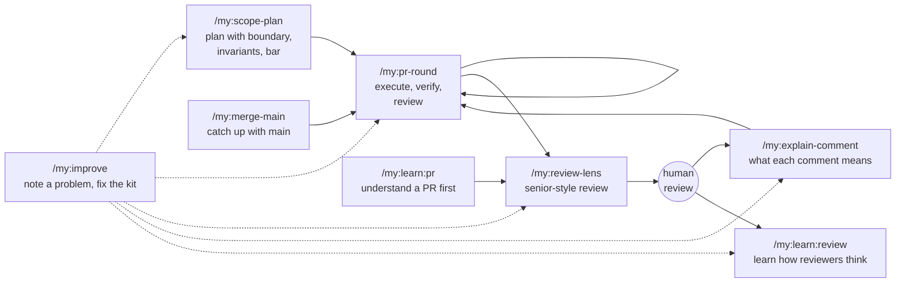

# my-agent-kit

A personal suite of skills for working on code with agents. It turns a task into a scoped plan, runs the work in autonomous rounds that stop only at agreed gates, reviews changes the way a senior colleague would, and gets better every time something goes wrong.

It ships as a Claude Code plugin named **`my`**, so every skill is one keystroke away: type `/my` and the menu lists them all.

## Why it exists

Long pull requests fail in predictable ways:

- the bar for "done" is set late, so reviews never converge;
- the boundary of the change is discovered halfway through;
- scope grows without a budget;
- claims go unverified;
- the developer ends up as a courier, carrying messages between agent sessions.

This kit encodes the fixes as reusable skills. It also keeps a log, so each new failure mode becomes a new fix.

## The workflow



You step in only at **gates**, which the plan agrees in advance:

1. approving the plan;
2. a decision outside the agreed bar or boundary;
3. marking the change ready for human review;
4. anything that gets published (PR text, review comments, replies, messages).

Between gates, agents work in the background, a verified round pushes to the draft branch on its own, and a desktop notification tells you when you are needed.

## A change, end to end

```text
/my:scope-plan ABC-123          interview → plan → worktree + branch from origin/main → ticket In Progress
/my:pr-round                    part A: triage → check → execute → verify → review → push → 5-line report
/my:pr-round                    next part, or the block findings from the last review
/my:merge-main                  when a round reports that main moved with conflicts
/my:pr-round                    … until the review says the bar is met → ready-for-review gate
/my:explain-comment             bots and reviewers answered → fixes feed the next /my:pr-round
/my:learn:review                ten minutes on how the reviewer thinks (only new comments)
/my:learn:pr 456                understand a colleague's PR first…
/my:review-lens 456             …then review it (reuses the reading)
/my:improve note <what>         whenever the kit itself gets something wrong
```

## Skills

| Command               | Stage       | What it does                                                                                                                                                                                                                                                | Status  |
| --------------------- | ----------- | ----------------------------------------------------------------------------------------------------------------------------------------------------------------------------------------------------------------------------------------------------------- | ------- |
| `/my:scope-plan`      | Before code | Interviews you with multiple-choice questions and writes the plan: goal, boundary, invariants with tests, bar for done, size budget, reviewers, gates. Adapts its depth to the kind and size of the task.                                                   | available |
| `/my:pr-round`        | During      | Runs one round: executes the work in the background, checks the result against git, reviews it against the plan, and reports in five lines with a drift signal.                                                                                             | available |
| `/my:merge-main`      | During      | Brings the branch up to date with main: previews conflicts, stops on design conflicts, regenerates generated files, re-checks migrations and the dev database. Accepts optional context ("keep their approach, adapt ours").                                | available |
| `/my:review-lens`     | Review      | Reviews a pull request, yours or a colleague's, through the lenses senior reviewers use: promised guarantees, state ownership, durability, every caller, rollback, the roadmap of others. Returns the questions to ask and findings graded against the bar. | available |
| `/my:explain-comment` | Review      | For each bot or colleague comment: two lines of plain explanation, whether it is real, its weight, a proportional action and a short reply draft.                                                                                                           | available |
| `/my:learn` | Learning | `pr <n>`: understand a PR before reviewing it (what and why, before → after, reading order, its promise, questions to keep in mind). `review <n>`: turn review comments into a three-layer study page; only comments not studied yet. Private, in your language, with a glossary and reviewer profiles. | available |
| `/my:improve`         | Always      | `note` logs a problem with the kit from any session; `run` turns open notes into approved changes, eval cases, a version bump and an updated README; `log` shows the history.                                                                               | available |

Skills with modes also have sub-commands, so the menu is navigable: `/my:learn:pr`, `/my:learn:review`, `/my:improve:note`, `/my:improve:run`, `/my:improve:log`. You rarely need the names: ask in plain words ("explain PR 456") and Claude picks the skill from its description.

## Principles

All skills share one set of rules, kept in [docs/principles.md](docs/principles.md):

- proportional rather than strict;
- the plan as contract;
- humans decide at gates;
- questions come with pros and cons;
- verify before deciding;
- repository rules are loaded explicitly;
- work always happens in a worktree.

## Install

**On the development machine**, link the repository into the personal skills folder. From the next session, Claude Code loads it automatically, straight from disk, as `my@skills-dir`:

```bash
ln -s ~/Workspace/my-agent-kit ~/.claude/skills/my
```

**On any other machine**, install it from the private GitHub repository. This uses your existing `gh` or git credentials:

```bash
claude plugin marketplace add lorenzocadamuro/my-agent-kit
claude plugin install my@my-agent-kit
```

The repository is private, so nobody else can install it.

## Improving the kit

The kit grows with use, but it never changes itself without approval.

1. **Note.** When something goes wrong in any session, run `/my:improve note <what happened>`. The note lands in `~/.my-agent-kit/suite-log.md`, with its context.
2. **Run.** In a dedicated session, `/my:improve run` groups the open notes and proposes changes with pros and cons. It applies only the ones you approve.
3. **Prove.** Each fixed note becomes an eval case in `evals/`. `claude plugin eval` must pass before the change lands, so a fixed problem cannot come back.
4. **Record.** Every run updates this README, `CHANGELOG.md` and the version in `.claude-plugin/plugin.json`, then commits and tags.

Changes take effect from the next session.

### Versioning

The kit follows [semantic versioning](https://semver.org):

- **patch** for wording and fixes;
- **minor** for a new skill or new behaviour;
- **major** when a command or its arguments change incompatibly.

## Repository layout

```
.claude-plugin/
  plugin.json        plugin manifest (name "my", version)
  marketplace.json   lets the private repo act as its own marketplace
skills/<name>/       one folder per skill, each with SKILL.md and its supporting files
commands/<skill>/    thin sub-commands that call a skill in one mode (/my:<skill>:<mode>)
evals/<skill>/       eval cases, one per problem the kit has learned from
docs/principles.md   rules every skill follows
docs/                question format, review lenses, local data layout
templates/           plan, project profile, round, round summary, log entry, reviewer profile, study page
scripts/check.sh     validation and privacy check, run by the pre-commit hook
scripts/verify-round.sh  checks a round summary against git
scripts/drift.sh     size versus budget, distance from main, conflict preview
.githooks/           git hooks (enable with: git config core.hooksPath .githooks)
.claude/CLAUDE.md    instructions for agents editing this repository
CHANGELOG.md         what changed in each version
```

## What never goes in this repository

This repository holds only generic, reusable material. Anything tied to an employer or to people stays local, in `~/.my-agent-kit/`:

- the improvement log and retrospectives;
- reviewer profiles and study pages;
- internal paths, project names, ticket or pull request numbers, and colleagues' names.

`scripts/check.sh` blocks a commit that contains any word listed in `~/.my-agent-kit/deny-words.txt`. That file is local and never committed.

## Development

```bash
git config core.hooksPath .githooks   # once per clone
scripts/check.sh                      # validate the plugin and run the privacy check
```

Evals run locally, never published; see [evals/README.md](evals/README.md):

```bash
claude plugin eval . --no-publish --runs 1 --max-cost-usd 12 --trust-plugin \
  --ablation none --allow-tools Bash Write Edit --scaffold -j 4
```
